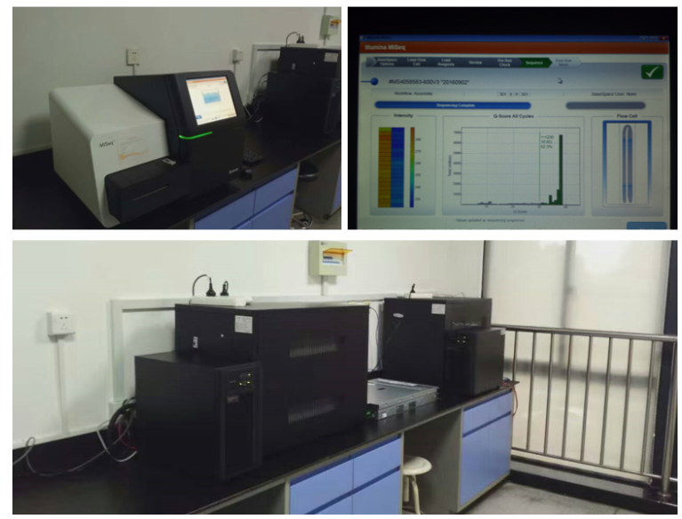

# Pathongs - 病原微生物测序数据分析平台

<div class=\"hero-section\" markdown=\"1\">

## 🧬 欢迎来到杭州市疾控中心测序实验室

**Pathongs** 是一个专注于病原微生物高通量测序数据分析的开源教程平台。我们致力于为公共卫生实验室人员提供实用的生物信息学分析指南和工具。

[开始学习教程 →](book/main.md){ .md-button .md-button--primary }
[查看实验方案 →](protocol.md){ .md-button }
<!-- [浏览最新动态 →](blog/index.md){ .md-button } -->

</div>

---

## ✨ 平台特色

<div class=\"features-grid\" markdown=\"1\">

### 📚 全面教程
从基础到高级，涵盖细菌、病毒等病原微生物的完整分析流程，包括基因组组装、注释、比较分析等。

### 🧪 实用方案
提供经过验证的实验方案和操作指南，特别针对新冠病毒等紧急病原体的测序分析。

### 🔧 工具集成
介绍各种开源生物信息学工具，包括命令行工具、可视化平台和自动化流程。

### 🎯 实战导向
所有教程都基于真实数据分析案例，帮助实验室人员快速上手实际工作。

</div>

---

## 📈 最新动态

### 🚀 近期更新

**2024年更新计划**
- [ ] 更新新冠病毒变异监测分析流程
- [ ] 添加宏基因组数据分析新方法
- [ ] 优化教程结构和用户体验

**2023年已完成**
- [x] 重构网站导航结构
- [x] 添加实验方案模块
- [x] 建立博客系统

### 📝 最新博客文章

<!-- 博客系统正在建设中 -->
- [我的vim配置](blog/my-vim-ide.md) - 2023年
- [Nanopore Guppy GPU加速配置](blog/nanopore-guppy-gpu.md) - 2023年

<!-- [查看更多博客文章 →](blog/index.md) -->

---

## 🧫 实验方案

<div class=\"protocol-cards\" markdown=\"1\">

### 🦠 新冠病毒测序方案

- [新冠病毒纳米孔测序常规流程](protocol/ncov19-nanopore-ligation.md)
- [新冠病毒高通量纳米孔测序流程](protocol/ncov19-nanopore-lowcost.md)
- [新冠病毒快速法纳米孔测序流程](protocol/ncov19-nanopore-rapid.md)
- [新冠病毒二代测序流程](protocol/ncov19-illumina-nextera.md)

### 🔬 其他病原体方案
*更多方案正在整理中...*

</div>

---

## 📖 教程体系

<div class=\"tutorial-structure\" markdown=\"1\">

### 基础篇
- **第零章**：开始之前 - 环境准备与基础知识
- **第一章**：常用工具 - 数据库、数据下载、基础工具

### 核心篇
- **第二章**：组装与比对 - 从原始数据到基因组
- **第三章**：基因组注释 - 功能注释与SNP分析
- **第四章**：基因组比较 - 比较基因组学分析

### 进阶篇
- **第五章**：泛基因组分析
- **第六章**：基因组可视化
- **第七章**：综合分析平台
- **第八章**：重组与种群分析

### 专题篇
- **专项教程**：命令行、Linux、编程语言等
- **实验手册**：具体实验操作指南

</div>

---

## 🏢 关于我们

**杭州市疾控中心微生物检验科病原微生物测序实验室**


自2011年起，我们开始关注NGS技术在疾控领域的应用。目前已经建立了完整的二代和三代测序实验室，配备了生物信息计算硬件设备。通过系统学习和实践，我们具备了应用测序技术开展病原应急防控的能力。

**我们的工作涵盖**：
- 流感病毒、登革热病毒、诺如病毒等病毒监测
- 霍乱弧菌、副溶血性弧菌、单增李斯特菌等细菌分析
- 沙门菌、空肠弯曲菌、蜡样芽胞杆菌等食源性病原研究



---

## 🤝 参与贡献

Pathongs是一个开源项目，我们欢迎所有对病原微生物测序数据分析感兴趣的人士参与贡献。

### 如何参与？
1. **报告问题**：在[GitHub Issues](https://github.com/indexofire/pathongs/issues)提交问题或建议
2. **改进内容**：通过Pull Request提交内容改进
3. **分享经验**：撰写博客文章或教程

### 快速开始贡献
```bash
# 克隆项目
git clone https://github.com/indexofire/pathongs.git
cd pathongs

# 设置用户信息
git config user.name \"你的用户名\"
git config user.email \"你的邮箱\"

# 创建新分支并开始工作
git checkout -b feature/your-feature-name
```

---

## 📞 联系我们

- **邮箱**: indexofire@gmail.com
- **GitHub**: [indexofire/pathongs](https://github.com/indexofire/pathongs)
- **问题反馈**: [提交Issue](https://github.com/indexofire/pathongs/issues)

---

<div class=\"footer-note\" markdown=\"1\">

> **注意**: 本平台内容主要基于Ubuntu/Linux环境，部分内容可能需要在相应环境下运行。建议使用Linux系统或WSL2进行学习和实践。

</div>